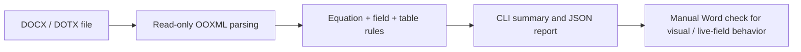

# Word Equation Toolkit

[](https://github.com/jaylee9605/word-equation-toolkit/actions/workflows/ci.yml)
[](.github/workflows/ci.yml)
[](LICENSE)
[](https://github.com/jaylee9605/word-equation-toolkit/releases/tag/v0.1.0)

**Catch equation-formatting problems in Microsoft Word documents—without changing the original file.**

Word Equation Toolkit is a small **read-only Python CLI** that examines the stored OOXML behind native Word equations, numbering fields, cross-references, bookmarks, and borderless equation tables. It turns repetitive document-quality checks into explicit, testable rules.

**中文简介：** 面向科研论文的 Word 公式格式校验工具。通过 Python 解析 DOCX 内部 OOXML，检查原生公式、自动编号、交叉引用、书签和公式表格结构，并输出可复现的诊断报告。**只读检查，不自动修改文档；不能替代 Word 中的最终视觉核查。**

**[Try the sample](examples/equation_sample.docx)** · **[Download v0.1.0](https://github.com/jaylee9605/word-equation-toolkit/releases/tag/v0.1.0)** · **[See a real validation report](reports/examples/valid_sample.json)**

## The problem

Word equations can look correct while their underlying structures are inconsistent: a `SEQ Eq` field may have an outdated displayed result, a `REF` field may point to a missing bookmark, or an invisible equation table may acquire an unintended border or column. Manually locating these issues across a manuscript is repetitive and error-prone.

This tool checks the **stored document structure** and reports what is wrong or cannot be established statically. It does **not** claim to reproduce Word's rendering engine or update fields.

## Quick start

Requires **Python 3.10–3.13** and `lxml`. Microsoft Word is **not required** to run the checker.

```bash
git clone https://github.com/jaylee9605/word-equation-toolkit.git
cd word-equation-toolkit
python -m pip install -r requirements.txt

# Audit the bundled editable Word sample
python src/equation_audit.py examples/equation_sample.docx

# Write a structured report
python src/equation_audit.py examples/equation_sample.docx --json reports/my_audit.json

# Or send JSON to stdout (human-readable summary goes to stderr)
python src/equation_audit.py examples/equation_sample.docx --json -
```

### Example: successful inspection

The bundled sample has **14 native math objects, 10 numbered equations, 10 SEQ fields, 10 REF fields, 10 matched bookmark pairs**, and **9 equation tables**. Its saved audit reports **0 errors and 0 warnings**.

```text
Word Equation Toolkit 0.1.0: PASS (static OOXML only)
Math: 14 native; 10 display; 4 inline.
Fields: 10 SEQ Eq; 10 REF. Bookmarks: 10 matched pairs.
Equation tables: 9; numbered rows: 10.
Stored numbering: pass. Input unchanged: True.
```

The excerpt is from the CLI summary; see the [full sample report](reports/examples/valid_sample.json), including checks that remain **unverified** until inspected in Word.

### Example: a detected defect

```bash
python src/equation_audit.py examples/negative/visible_border.docx
```

This deliberately defective file triggers `VISIBLE_EQUATION_BORDER` because an equation table declares a visible top border. The command returns exit code **1**; see the [negative-case report](reports/examples/visible_border.json).

## What v0.1.0 checks

| Area | Checks |
| --- | --- |
| **Native equations** | Counts editable `m:oMath` / `m:oMathPara` objects; verifies stored matrix dimensions |
| **Numbering** | Reads `SEQ Eq` instructions and stored numeric results; flags supported numbering inconsistencies |
| **Cross-references** | Reads `REF` instructions, cached values, missing targets, and bookmark pairing/uniqueness |
| **Equation layout** | Checks the documented three-column layout: cells, widths, symmetry, field placement and alignment |
| **Borders** | Detects explicitly visible table/row/cell borders; warns when inherited style behavior is uncertain |
| **Document integrity** | Performs basic OOXML package, relationship and XML safety checks; verifies the input was unchanged |
| **Line numbering** | Reports stored section line-numbering settings, including continuous mode, as information |



**The key boundary:** `PASS (static OOXML only)` means the supported stored-structure checks found no errors. It is **not** certification of the rendered pages, actual equation positions, live cross-reference updates, or confidentiality.

## Editable Word example and template

- [`examples/equation_sample.docx`](examples/equation_sample.docx): a **three-page** demonstration using elementary mathematics, native editable equations, automatic numbers **(1)–(10)** and `REF` cross-references.
- [`templates/equation-template.dotx`](templates/equation-template.dotx): a genuine editable OOXML Word template, not a renamed DOCX.
- The sample deliberately preserves **continuous native line numbering 1–30**, useful for manuscript review.
- Its numbered equations use a **three-column, borderless table** with a symmetric **1,310 / 6,740 / 1,310 twip** grid. One table contains two numbered rows.
- Equation (7) is a **five-row, two-column native mathematical matrix**. Renderer-specific display artifacts do not by themselves prove damaged OMML.

To extend the example, work on a **copy**. Keep native math objects and field codes. Each added numbered equation needs a real `SEQ Eq` field and a **unique** bookmark; references should use `REF` fields. Copying a table row does not automatically generate new bookmark identities.

## Tests and reproducibility

The repository contains **80 automated tests** covering ordinary and malformed inputs. GitHub Actions runs the tests and sample CLI on **Python 3.10, 3.11, 3.12, and 3.13**.

```bash
python -m pip install -r requirements-dev.txt
python -m pytest -q --color=no

# Rebuild the synthetic test fixtures and example reports
python tools/generate_examples.py
```

Five synthetic negative examples test broken bookmarks, missing reference targets, malformed equation tables, missing `SEQ` fields and visible borders. See [examples/README.md](examples/README.md) and [recorded test evidence](reports/test_results.txt).

**Safety by design:** the validator does not save the inspected Word file. It compares the input SHA-256 before and after inspection, rejects a JSON output path that aliases the input, and writes reports via atomic replacement. The CLI has **no network or AI API calls**.

### CLI exit codes

| Code | Meaning |
| :---: | --- |
| `0` | No detected static errors; warnings or unverified checks may still remain |
| `1` | One or more static errors were detected |
| `2` | The input or requested output could not be processed |

If the tool emits `PASS WITH WARNINGS`, review the warnings; in particular, `BORDER_STYLE_UNVERIFIED` means it cannot prove a borderless appearance. Warnings are not silently counted as successful visual verification.

## Manual verification in Microsoft Word

Static OOXML checks cannot update live Word fields or prove actual appearance. After editing a manuscript or using another Word/font environment, verify a **disposable copy**:

1. Use **Ctrl+A → F9** in Word to update main-document fields; repeat if some cached references are still stale. On some keyboards, use **Fn+F9**. Header/footer fields may require separate updating.
2. With the provided sample, check **three pages**, continuous line labels **1–11 / 12–20 / 21–30**, equation numbers **(1)–(10)**, and absence of missing-reference errors.
3. Insert a numbered equation after (1), using a real `SEQ` field and unique bookmark. Update fields; expect **11** numbered equations and later references shifted accordingly. Remove the new equation and update again; the original numbers should return.
4. Confirm equation centering, right-aligned numbering, invisible borders and editable symbols in the five-row matrix. Do not overwrite the distributed baseline.

The bundled sample has previously been reviewed in Word 16.0; see [verification notes](reports/word_sample_verification.md). That check applies to the recorded sample bytes, **not** to arbitrary documents.

## Technical scope and limitations

The tool is intentionally a **format-specific static validator**, not a universal DOCX linter.

- **Field evaluation:** supports stored ordinary increments, `\n`, `\r <integer>`, `\c`, `\h` and `\* ARABIC` switches. Split instructions and nested simple/complex fields are parsed. Unsupported/conflicting controls, hidden/missing caches and uncertain numbering remain **unverified**. Different document stories are evaluated separately.
- **Border inheritance:** explicitly visible border declarations are errors. A verified static borderless result requires all six physical table borders to be set to `nil`/`none` without unresolved conditional/cell style effects. Incomplete, inherited or ambiguous styles yield `BORDER_STYLE_UNVERIFIED`. The full Word border-conflict algorithm, glyph rendering and actual painted appearance are not implemented.
- **Layout:** validated table geometry targets the supplied **three-cell equation layout**; arbitrary nested/merged/floating tables, text boxes, multi-column pages, conditional style semantics, tracked changes and Strict OOXML are outside this layout contract.
- **Container security:** macro-enabled main document types, duplicate/encrypted ZIP parts, DTDs and packages above **100 MiB uncompressed / 10,000 parts** are rejected. XML external entity resolution and network loading are disabled. External package relationships are flagged for review.
- **Unverified:** real-world pagination and line labels, visual alignment, font compatibility, live `SEQ`/`REF` recalculation, and comprehensive document privacy/metadata review. Metadata inventory is **not** a privacy certificate.
- **Environment:** other platforms, Python 3.14+, and other Python implementations are not claimed tested.

## Build a release ZIP

```bash
python tools/package_release.py
# Or specify an output destination:
python tools/package_release.py --output ../word-equation-toolkit-v0.1.0.zip
```

The default archive is `dist/word-equation-toolkit-v0.1.0.zip`. An allowlisted `RELEASE_MANIFEST.json` records SHA-256 hashes for included files; Git data, caches, environments and temporary Word files are excluded. ZIP order, timestamps and permissions are normalized for reproducible builds under the tested conditions. Packaging **does not** rerun tests, perform a new privacy audit or publish anything.

For a verified public distribution, use the [v0.1.0 GitHub Release](https://github.com/jaylee9605/word-equation-toolkit/releases/tag/v0.1.0) and its checksum attachment. See also [release notes](RELEASE_NOTES.md) and [release-readiness report](reports/release_readiness.md).

## License

MIT License — [full text](LICENSE) · [licensing scope](LICENSING.md). Microsoft Word and fonts are not included; separately installed dependencies retain their own licenses.
